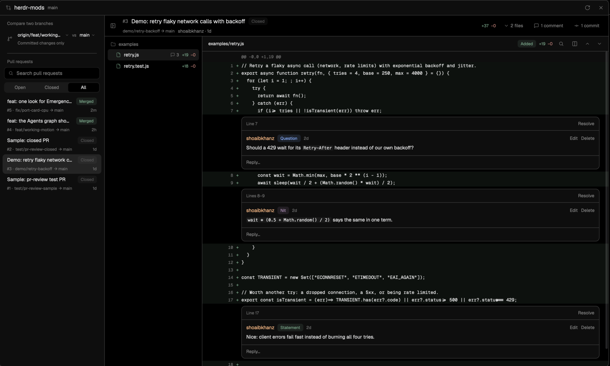

# Emergence

A [Herdr](https://herdr.dev) layout for running many coding agents at once: an agent graph, a PR reviewer, a skills
library, usage analytics, and a sidebar with every worktree and the agents that need you.


## Install

Tell your Herdr agent:

> Read ~/.config/herdr-app/AGENTS.md, then add this layout by running its install.sh: https://github.com/shoaibkhanz/emergence

Or run it yourself:

```sh
curl -fsSL https://raw.githubusercontent.com/shoaibkhanz/emergence/main/install.sh | bash
```

It clones to `~/code/emergence` (`EMERGENCE_DIR` moves it), links every mod, adds the [keys](#keys) and switches to
the `emergence` layout (`⌘⇧L` cycles back). Old copies of its mods are moved to `~/.config/herdr-app/replaced/`. Needs
Herdr 0.1.15+, `git`, `python3`; `gh` (or `glab`) for pull requests. To update later, see [Update](#update-or-remove).

## What you get

Screenshots use made-up data.

### Agents (⌘⇧A)


Every agent as repo → worktree (with its PR) → agent → sub-agents. Blocked in red, working in amber, done in green;
**Active only** hides idle ones. Click an agent to jump to it, a PR to review it.

### PRs (⌘⇧R)



The repo's GitHub PRs or GitLab merge requests, and any two-branch compare: file tree, unified or side-by-side diffs,
inline threads. Comments carry a tag (Statement · Question · Nit · Minor · Major) that posts as a badge. Find (⌘F) across code and comments,
step through commits with [ ], reply, edit, resolve. Refreshes every 5 s. Full size keeps the agent's terminal beside
it; it also opens in its own window.

### Library (⌘⇧K)


Every skill in `~/.agents`, `~/.claude`, `~/.codex`, `~/.config/opencode` and the repo, plus Claude Code plugins, in
one searchable list showing where each lives.

### Usage (⌘⇧U)

Cost and output across omp, Claude Code, Codex, OpenCode and pi, from their local logs and your git history. Any
period; drag across a chart and every number follows, until you clear the pick (✕ on its chip, top right). Nothing
leaves your machine.

<table>
<tr>
<td width="50%"><br><b>Overview.</b> Sessions, tokens,
spend and cache share against the period before.</td>
<td width="50%"><br><b>Compare.</b> Clean-run rate (95%
range), cost per clean run and commits, per harness and model.</td>
</tr>
<tr>
<td><br><b>Harnesses.</b> Tokens, models and effort
per harness over time.</td>
<td><br><b>Output.</b> Commits, lines, PRs, worktrees, and
their cost.</td>
</tr>
<tr>
<td><br><b>Rhythm.</b> When you work, agents at once, run
lengths.</td>
<td valign="top">Only this machine's logs count. Claude Code prunes transcripts after 30 days (<code>cleanupPeriodDays</code>);
Usage keeps every session it has read.</td>
</tr>
</table>

### Sidebar


- **Spaces**: every worktree under its repo, with ↑/↓ commits and agent status; greyed ones aren't open yet (↵ opens).
  On a worktree, ← deletes it (`git worktree remove`; refused with uncommitted changes, branch kept) and → archives it
  (hidden, still on disk; reopen from ⌘E). Right-click for the same. Both ask first (Cancel selected), then leave
  the keyboard in Spaces.
- **Inbox**: every agent waiting on you, newest first, including a blocked sub-agent another agent started (click to
  peek at it); Settle puts one away.
- **Ports**: every server listening on this Mac and the agent that started it. One started outside Herdr says by
  what ("Claude app", "Codex in iTerm"); "Claude ended" means the agent session that started it has ended but the server still runs (amber past an hour); a half-strength icon means probably that agent (started in the background, matched by
  folder); a globe means your network can reach it. Click (or ↵) for its card: address, agent, command, uptime, CPU
  and memory, with Open, Go to agent and Stop (asks first, and checks the process still holds the port).
- **Working N**, the last row: opens the graph on what's working (everything at 0).
- **Sizes**: open, rail, dots (⌘B, ⌘⌥B).

### Status bar

CPU, memory, free disk and (on battery) battery, amber or red when high: CPU at 80%, memory under pressure (not just
full: macOS fills it with cache), disk under 10% / 5% free, battery under 20% / 10%. Click one for **System**: what
each agent and the top processes use (click an agent to go to it; a port chip opens that port's card), and on Disk
the size of every worktree of the repos you have open.

### Jump (⌘E)

Every tab and unopened worktree, most recent first; ⌘E ↵ flips between your last two. Type to filter (a space's name
finds its worktrees too), or a new branch name to make a worktree. Unnamed tabs follow their branch.

## Keys

Added without replacing yours; all but ⌘E only in the `emergence` layout. ⌘⇧/ (or the tab bar's keyboard button)
lists them all. Closing something gives the keyboard back to where it was: Jump, the keys list, a worktree dialog
or menu to Spaces, the Inbox or the panel you opened it from; a panel's window or popup to the panel.

| Key | Where | What |
|---|---|---|
| ⌘E | everywhere | Jump |
| ⌘⇧/ | layout | every Emergence key (⌘/ is Herdr's) |
| ⌘⇧A · ⌘⇧R · ⌘⇧K · ⌘⇧U | layout | Agents · PRs · Library · Usage |
| ⌘⇧I | layout | keyboard into the Inbox |
| ⌘⇧O | layout | worktrees of this repo |
| ⌘B · ⌘⌥B | layout | sidebar open/fold · one size thinner |
| ↑ ↓ · ↵ | sidebar | move · open |
| ← → | Spaces | repo: fold · worktree: delete / archive |
| ctrl-j · ctrl-k · ctrl-l | sidebar | down (Spaces → Inbox → Ports) · up · back to the terminal (also Esc) |
| ↵ · ← | Ports | the port's card · stop it (asks first) |
| ↑ ↓ · ← → · ↵ · Esc | panels | list · tabs · open · step back, then back to the terminal |
| ⌘F · [ ] | PRs | find · previous / next commit |
| ctrl-h/j/k/l | terminals | between panes ([optional](#optional-ctrlhjkl-between-panes)) |

Not ⌘⇧J (Homerow's scroll mode); not ⌘⇧B (Blueprint).

## What it runs

- **Agents**: `git rev-parse` per agent folder; `gh pr list` (or `glab mr list`) per repo each minute.
- **PRs**: `git` and `gh` (or `glab`, by the repo's remote) in the focused repo; comments go through that forge's API.
- **Library**: lists the skill folders above and `~/.claude/plugins/installed_plugins.json`.
- **Usage**: `mods/usage/scan.py` reads session logs (counts, models, timestamps; never prompts), cached in Herdr's
  `data/usage/`; `output.py` runs `git log`, `gh`/`glab` and `git worktree list`.
- **Spaces**: `git rev-parse`, `rev-list`, `worktree list`, `for-each-ref`; delete runs `git worktree remove`.
- **Tab bar**: an hourly `git fetch` of `main` into your clone, for the [Update](#update-or-remove) chip.
- **Inbox**: nothing outside Herdr.
- **Status bar**: `ps`, `vm_stat`, `sysctl` every 5 s; `df` and `pmset` each minute. System, while open: the same, plus
  `lsof` once and, on Disk, `git worktree list` and `du -sk` per worktree (kept 5 minutes).
- **Ports**: `lsof` and `ps` every 5 s while the sidebar is open, `git rev-parse --show-toplevel` once per agent
  folder; the card runs `ps` on its one process, and Stop runs `lsof` on it, then `kill` (SIGTERM).

## Update or remove

**Update**: when `main` has new commits, an **Update** chip appears in the tab bar (it checks at start and then
hourly). Click it: it pulls, relinks new mods and keys, and reloads the layout. It only appears for a clone on `main`
with no commits of its own; otherwise pull yourself and rerun the install command above.

**Remove**: `herdr-app do layout.switch --name main`, delete the links
(`find ~/.config/herdr-app/mods ~/.config/herdr-app/layouts -maxdepth 1 -lname "$HOME/code/emergence/*" -delete`, with
your `EMERGENCE_DIR` if you moved it), then remove the `tabs-plus.*`, `mod.open:jump`, `mod.open:emergence-keys`,
`mod:spaces-plus`, `mod:inbox` and `mod:ports` entries from `~/.config/herdr-app/keys.json` and `omp` from
`programs.json`, and delete the clone.

## Optional: ctrl-h/j/k/l between panes

`nav-keys` moves between panes, handing the key to (n)vim where it runs. Bind it (the keys then stop reaching your
shell):

```json
"terminal": { "ctrl-h": "nav-keys.left", "ctrl-j": "nav-keys.down", "ctrl-k": "nav-keys.up", "ctrl-l": "nav-keys.right" }
```

To also leave (n)vim at a split edge, add [herdr-nav-plus](https://github.com/shoaibkhanz/herdr-nav-plus)'s editor
map (`editor/vim.vim` for Vim):

```sh
mkdir -p ~/.config/nvim/after/plugin
curl -fsSL https://raw.githubusercontent.com/shoaibkhanz/herdr-nav-plus/main/editor/nvim.lua \
  -o ~/.config/nvim/after/plugin/herdr_nav.lua
```

## Develop

| Path | What |
|---|---|
| `mods/agent-graph`, `pr-review`, `skills`, `usage` | the four panels |
| `mods/inbox`, `spaces-plus`, `ports` | the sidebar |
| `mods/port-card` | a port's card |
| `mods/status-plus` | the status bar and its System popup |
| `mods/tabs-plus` | tab bar, panel buttons, tab names, updates |
| `mods/jump` | ⌘E |
| `mods/emergence-keys` | ⌘⇧/ |
| `mods/confirm-safe`, `row-menu` | Cancel-first confirm; right-click menu |
| `mods/nav-keys` | ctrl-h/j/k/l |
| `layouts/emergence.json` | the layout |
| `RECIPE.md` | how to rebuild it |

`spaces-plus`, `tabs-plus`, `status-plus` and the layout are copies of Herdr 0.1.15's own.

```sh
herdr-app check ~/.config/herdr-app/mods/<name>   # load and render once
(cd mods/<name> && bun test)                      # Usage also: python3 mods/usage/test_scan.py
bash install.test.sh                              # the installer and updater, in throwaway homes
```

Every push to `main` reaches people through the Update chip, so CI (`.github/workflows/check.yml`) runs all of the
above but `herdr-app check` on each push, and `main` is never force-pushed (clones could no longer fast-forward).

Edits need a reload: switch to `main`, then back to `emergence`. Read [`docs/platform-notes.md`](docs/platform-notes.md)
first.

MIT ([`LICENSE`](LICENSE)). Icons: [Lucide](https://lucide.dev) (ISC); omp's icon is its own (MIT).
